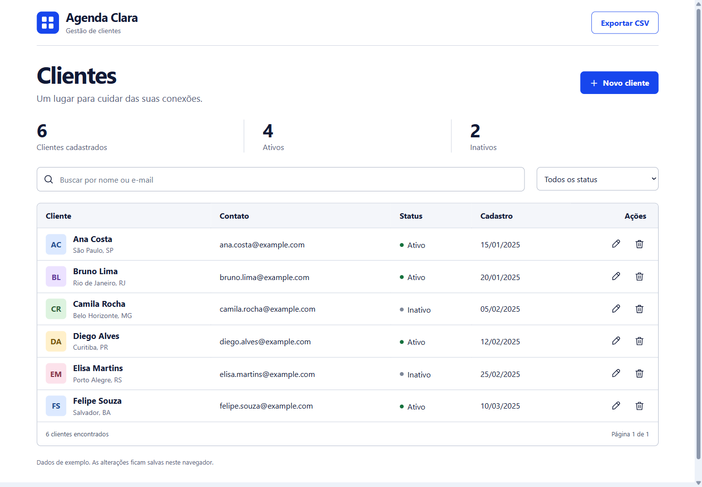

# Agenda Clara · CRUD de clientes

Aplicação front-end da **Tarefa 2: Meu primeiro deploy na nuvem de uma aplicação front-end**.

**Autor:** Sérgio Luiz Muniz Botelho Junior  
**Tecnologias:** HTML5, CSS3 e JavaScript puro, sem frameworks ou dependências de execução.

**Aplicação publicada:** https://agenda-clara-crud.vercel.app/  
**Repositório:** https://github.com/Sergiomunizss/agenda-clara-crud

O repositório está vinculado ao projeto `agenda-clara-crud` na Vercel, com a branch
principal `main` como origem dos deploys de produção.



## O que a aplicação permite

- **Create:** cadastrar cliente com nome, e-mail, telefone, cidade/estado e status.
- **Read:** consultar a lista, buscar por nome/e-mail e filtrar ativos/inativos.
- **Update:** editar os dados de um cliente existente.
- **Delete:** excluir um cliente com confirmação antes da remoção.
- Exportar os resultados filtrados em CSV, inclusive os de outras páginas.
- Manter os registros no navegador com `localStorage` após recarregar a página.

O layout utiliza **CSS Grid e Flexbox** e se adapta a celulares, tablets e computadores.
Inclui rótulos nos campos, navegação por teclado, foco visível, validação, mensagens de
resultado, lista vazia, confirmação de descarte e proteção contra duplicidade de e-mail.

## Como executar

1. Baixe ou clone este repositório.
2. Abra `index.html` em um navegador moderno (Chrome, Edge ou Firefox).
3. Opcionalmente, use a extensão Live Server do VS Code ou um servidor estático local.

Com Python instalado, uma alternativa é executar na pasta do projeto:

```bash
python -m http.server 8000
```

Depois, abra `http://localhost:8000`.

## Organização

```text
index.html       Estrutura semântica da página e formulários
style.css        Estilos externos, componentes e responsividade
script.js        Eventos, DOM, CRUD, filtros, exportação e persistência
favicon.svg      Ícone local da aplicação
docs/preview.png Captura real da aplicação
DESIGN.md        Decisões visuais e tokens
UX-CONTRACT.md   Regras dos fluxos e tratamento dos estados
```

## Front-end e futuras chamadas de API

O exercício não utiliza back-end. Em `script.js`, as quatro integrações REST estão
**comentadas**, junto das respectivas operações:

| Operação | Chamada futura |
|---|---|
| Consultar | `GET /api/clientes` |
| Cadastrar | `POST /api/clientes` |
| Atualizar | `PUT /api/clientes/:id` |
| Excluir | `DELETE /api/clientes/:id` |

Nenhum desses exemplos é executado. Os dados são manipulados em memória e gravados
localmente. Uma integração real precisaria de validação no servidor, autenticação,
autorização e tratamento dos retornos HTTP.

## Publicação no GitHub e na Vercel

Para este projeto estático, importe o repositório na Vercel com:

- **Framework Preset:** Other.
- **Root Directory:** raiz do repositório.
- **Build Command:** sem comando de build.
- **Output Directory:** `.` (raiz).
- **Environment Variables:** nenhuma.

Depois da vinculação, os envios para a branch principal podem gerar novos deploys
automaticamente. Referência: [Vercel for GitHub](https://vercel.com/docs/git/vercel-for-github).

## Validação realizada

30 verificações em navegador Chromium, incluindo ciclo completo de CRUD, cancelamento,
validação, persistência após recarregar, busca, filtro, paginação, exportação CSV,
texto tratado sem execução de HTML, falha de armazenamento e conflito de edição
entre abas. Layout inspecionado em 1440, 768, 390 e 320 pixels de largura.

Axe-core 4.14.0 não encontrou violações automatizadas nas telas de lista e formulário
desktop, com regras WCAG A/AA até 2.2. Isso não equivale a uma certificação de acessibilidade.

## Limites da demonstração

Os seis registros iniciais são fictícios e usam e-mails `example.com`. Utilize dados de
teste. O armazenamento é específico do navegador, perfil e endereço do site; não há
compartilhamento de dados entre usuários/dispositivos. Limpar os dados do navegador
remove os cadastros. Uma lista vazia salva permanece vazia após recarregar.
